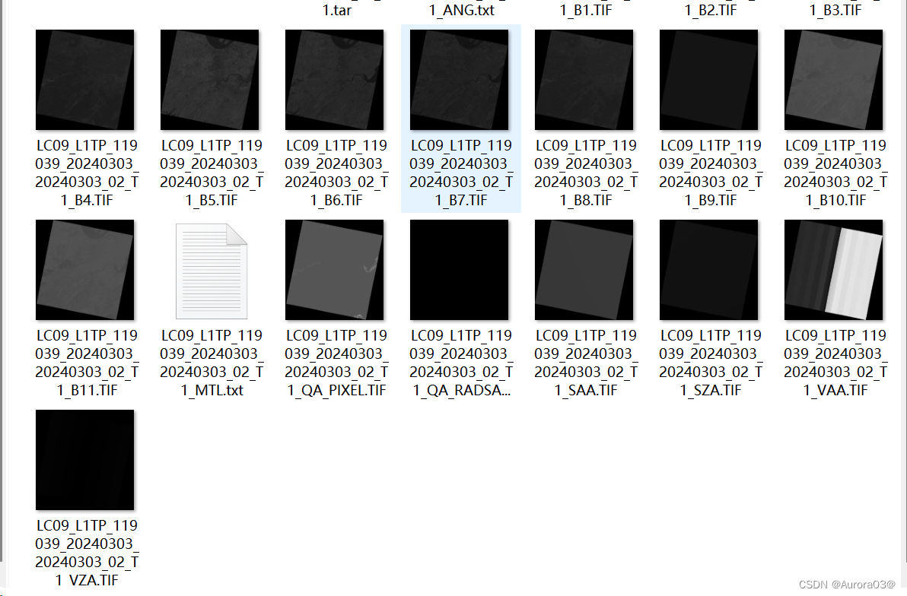
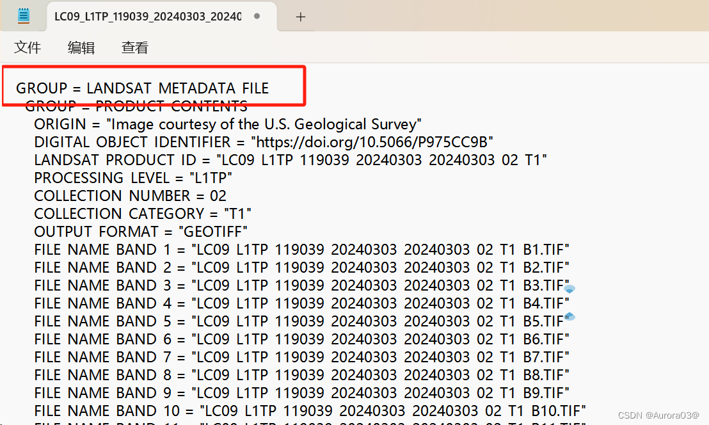
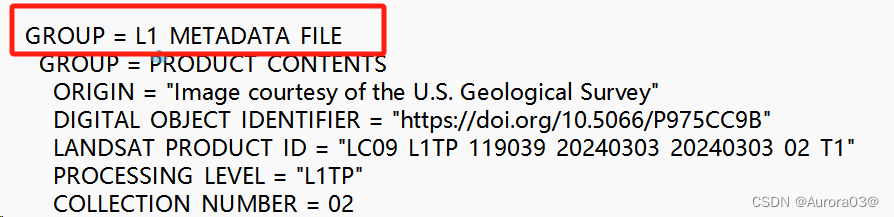
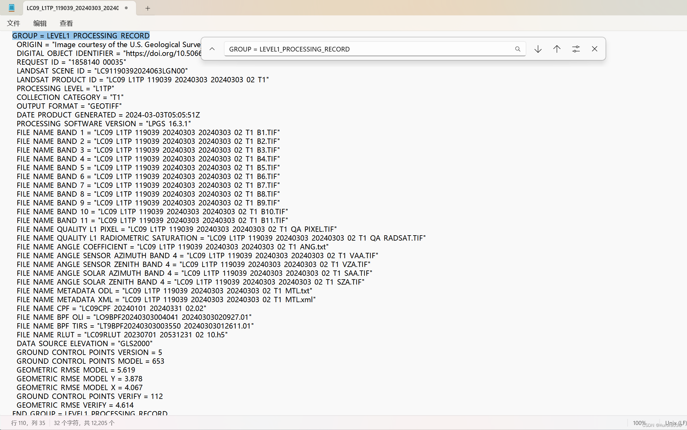
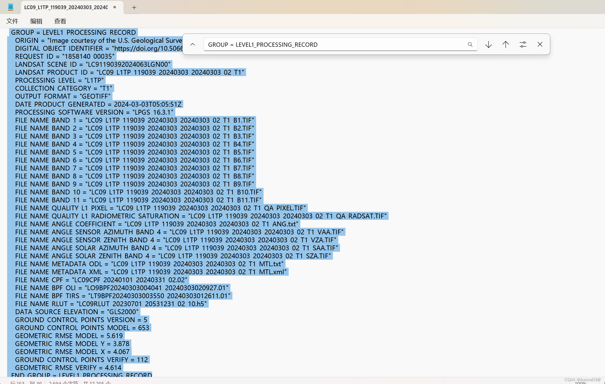
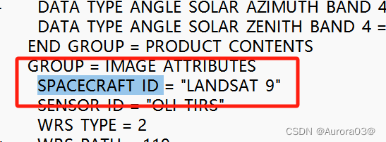
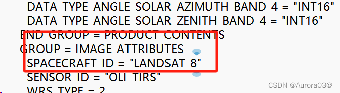
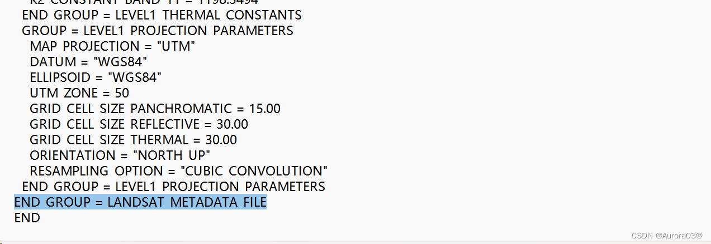

## 1. 环境准备

- 版本：**ENVI 5.3**
- Landsat 影像数据来源：美国地质勘探局（可能需要魔法）
- 在线图库：[USGS.gov | Science for a changing world](https://www.usgs.gov/)

## 2. 打开方式

**方法：修改头文件（MTL.txt）。**

首先，打开下载数据的 **Landsat 9 数据的 TXT 格式**元数据文件，下图中 `LC09_L1TP_119039_20240303_20240303_02_T1_MTL.txt` 文件：

进入后将首行 `GROUP = LANDSAT_METADATA_FILE` 改为 `GROUP = L1_METADATA_FILE`：

更改为：

`Ctrl + F` 查找 `GROUP = LEVEL1_PROCESSING_RECORD`，分别在第 110 行和 153 行左右出现两处：

### 删除 `GROUP = LEVEL1_PROCESSING_RECORD` 到 `END_GROUP = LEVEL1_PROCESSING_RECORD` 这部分的代码

`Ctrl + F` 查找 `SPACECRAFT_ID = "LANDSAT_9"` 更改为 `SPACECRAFT_ID = "LANDSAT_8"`：

找到文件最后的 `END_GROUP = LANDSAT_METADATA_FILE` 改为 `END_GROUP = L1_METADATA_FILE`：

然后就可以在 ENVI 中正常打开啦。
