## 1 数据

ERA5（fifth generation ECMWF atmospheric reanalysis of the global climate）是由欧洲中期天气预报中心（European Centre for Medium-Range Weather Forecasts，ECMWF）开发和维护的一种全球范围内的高分辨率大气**再分析数据集**，提供了多种气象和气候变量的连续、一致和高质量的数据。

ERA5 基于全球观测数据、数值模型和物理参数化方案，通过数据同化和数值模拟的技术，对过去数十年（1940 年至今）的天气状况进行再构建和模拟，从而生成了高时空分辨率的大气和地表变量数据。

ERA5 提供了广泛的气象和气候变量，包括温度、湿度、风速、降水、云量、地表辐射、地表温度等。这些数据以固定的时间间隔（逐小时或逐月）和空间分辨率（从数公里到数十公里）提供，可以用于气候研究、天气分析、气候模型验证、环境监测等众多应用领域。

## 2 下载方法（全程需要科学上网）

### 2.1 准备工作

首先我们需要从哥白尼气候数据存储 (Copernicus Climate Data Store - CDS) 下载 ERA5 数据。访问 CDS 网站并登录：[https://cds.climate.copernicus.eu/](https://cds.climate.copernicus.eu/)。（如果是首次使用，请注册一个免费账号并登录。）点击注册按钮，使用邮箱注册填写相关信息即可，不做过多阐述，注册成功后会向注册的邮箱发送一封激活账号的邮件。点击邮件里面的链接即可激活账号登录。

> 图 1 注册与账号激活操作界面

接下来我们需要配置运行 Python 程序的环境，这里我们选用的是 Anaconda 或者 Miniconda（轻量级版本），Anaconda 是一个用于管理 Python 环境和软件包的工具。按照以下的指令即可完成 Python 程序运行环境的配置。

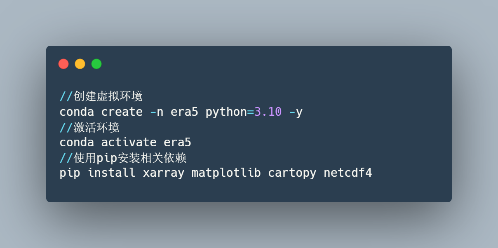

后续需要用到的 python 包可以使用 `pip install` 安装。

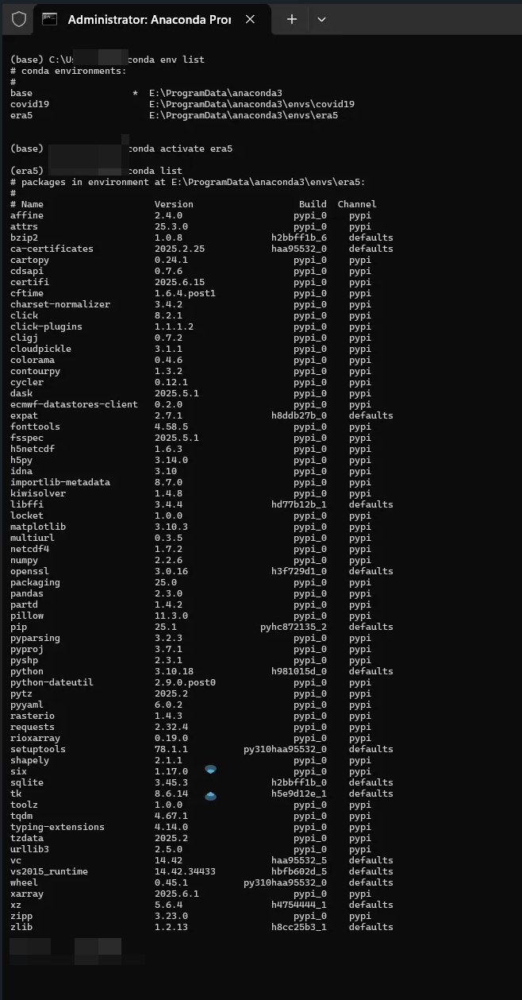

> 图 2 Python 运行环境配置

### 2.2 手动下载

我们需要选择正确的数据集，在 CDS 网站上，导航到或直接访问以下链接：[ERA5 hourly data on single levels from 1940 to present](https://cds.climate.copernicus.eu/datasets/reanalysis-era5-single-levels)，搜索：ERA5 hourly data on single levels from 1940 to present（ERA5 每小时单层数据，时间范围从 1940 年至今），选择列表中的第一条数据。

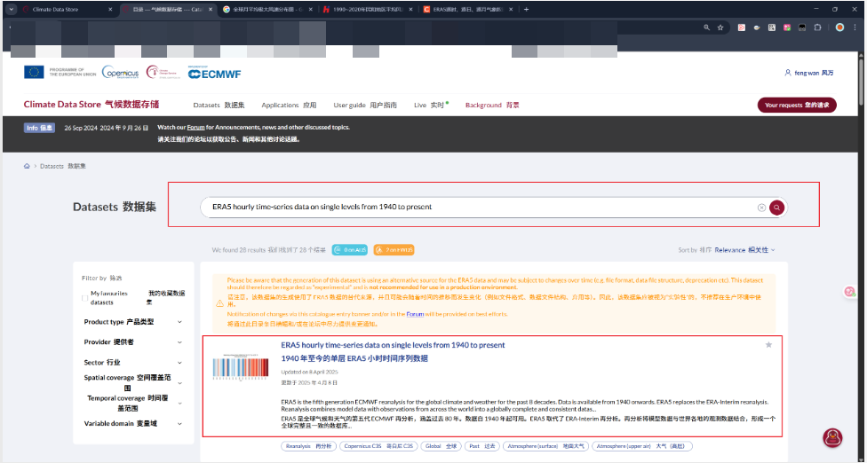

> 图 3 ERA5 hourly data on single levels from 1940 to present

接下来需要配置下载参数，在数据集页面，点击 "Download data" 选项卡。

- **Product type（产品类型）**：选择 Reanalysis。
- **Variable（变量）**：找到并勾选 **10 metre wind gust（10 米极大风速）**。
- **Year（年份）**：选择 2024。
- **Month（月份）**：分别选择 January（1 月）和 July（7 月）。您可以一次性选择这两个月，CDS 通常会生成两个独立的文件。
- **Day（日期）**：选择 All。
- **Time（时间）**：选择 All。
- **Geographical area（地理区域）**：保持默认的 Global（全球）。
- **Format（格式）**：选择 NetCDF (experimental)。虽然标记为实验性质，但是在使用 Python 脚本解析 NC 数据时候会非常方便。

在确认所有选择无误后，点击页面底部的 Show Form，然后点击 Submit Form。开始下载，CDS 服务器会根据您的请求准备数据，这可能需要一些时间。

数据准备好后，页面上会出现一个下载链接。点击链接将文件下载到本地存储文件夹。记住文件的存储位置和文件名（`era5_wind_gust_2024_01.nc` 和 `era5_wind_gust_2024_07.nc`）。

### 2.3 通过 Python 使用 API 下载

官方提供了 API 请求数据接口，如下图所示，点击 API，但是这里需要配置一下 url 和 api key。

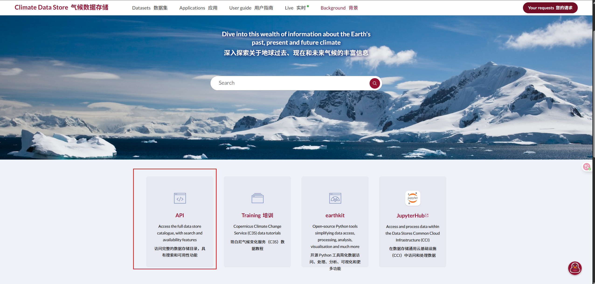

> 图 4 API 下载入口

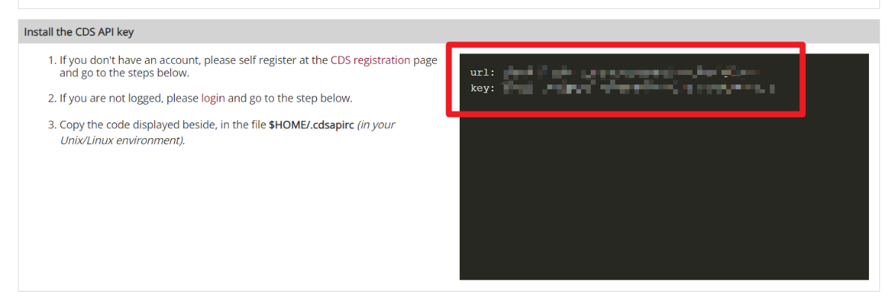

> 图 5 URL 与 API Key 配置

使用下面的代码进行 API 请求数据，请求之后，其实可以跳转到官方页面使用浏览器下载，程序的控制台下载较为缓慢且容易中断。

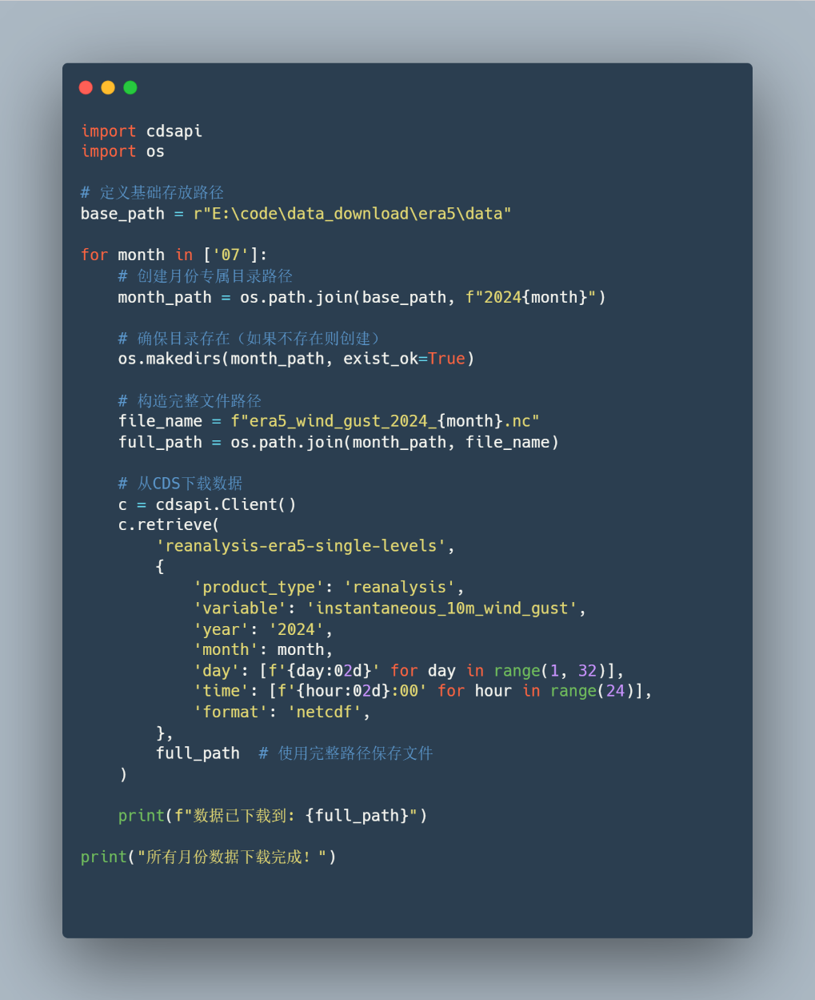

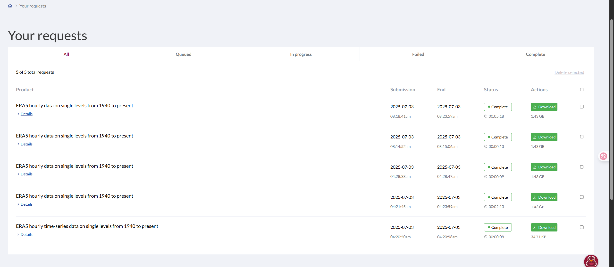

> 图 6 官网请求之后的数据下载界面

稍微等待一会儿即可下载完成，注意配置好自己的下载路径。

## 3 数据处理

下载得到的 NC 数据主要有以下内容：原始 NC 文件（`era5_wind_gust_2024_01.nc` 和 `era5_wind_gust_2024_07.nc`）包含以下维度与变量：

**维度（Dimensions）：**
- `valid_time`：时间维度（744 个时间点，对应 1 月份 31 天 × 24 小时 = 744 小时）
- `latitude`：纬度维度（721 个点，从 90°N 到 90°S）
- `longitude`：经度维度（1440 个点，0° 到 359.75°，间隔 0.25°）

**坐标变量（Coordinates）：**
- `number`：一个标量（大小为 8 字节）
- `valid_time`：时间坐标（数据类型为 `datetime64[ns]`）
- `latitude`：纬度坐标（从 90 到 -90，间隔 0.25°）
- `longitude`：经度坐标（从 0 到 359.75，间隔 0.25°）
- `expver`：实验版本（字符串，每个时间点都有一个，例如 '0001'）

**数据变量（Data variables）：**
- `i10fg`：瞬时 10 米风速（单位：m/s），这是一个三维数组（时间 × 纬度 × 经度）

**属性（Attributes）：**
包括数据来源（ECMWF）、参数 ID（`GRIB_paramId`）、单位（m/s）等。

这段代码是前置需要配置的一些中文字体和打印输出语句，用来显示进度。

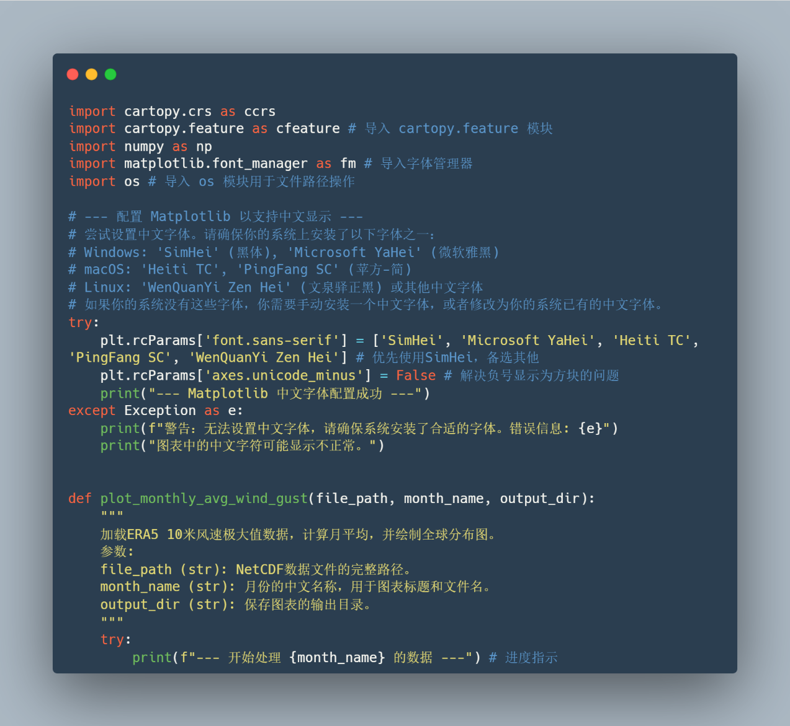

下面的这段代码是进行第一步加载数据，加载 Dataset 对象并且找到正确的 10 米极大风速变量名。

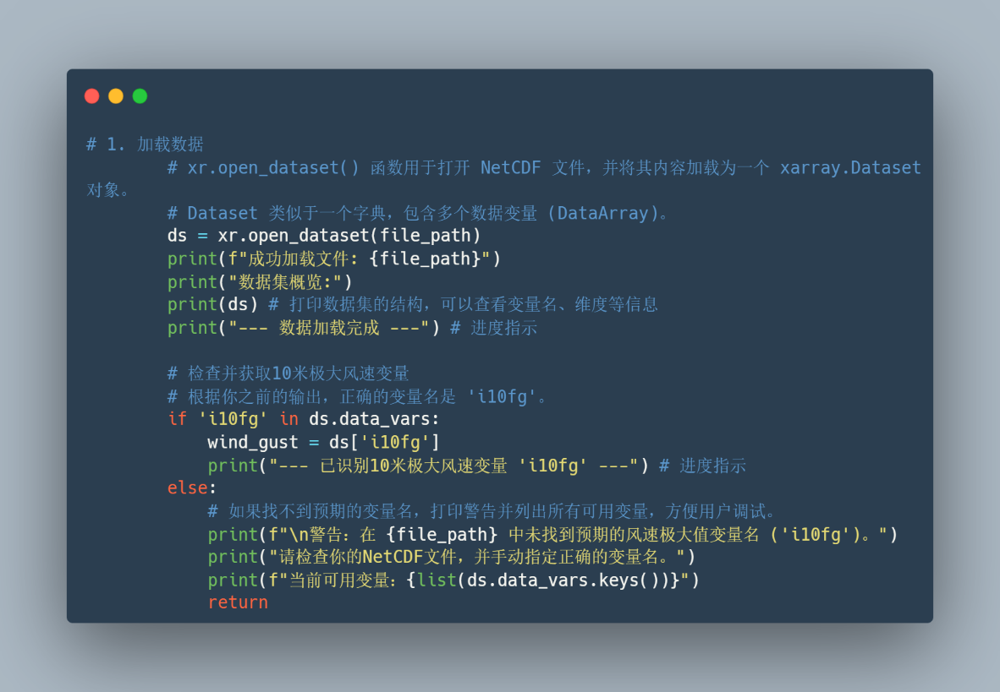

第二步是计算月平均极大风速。

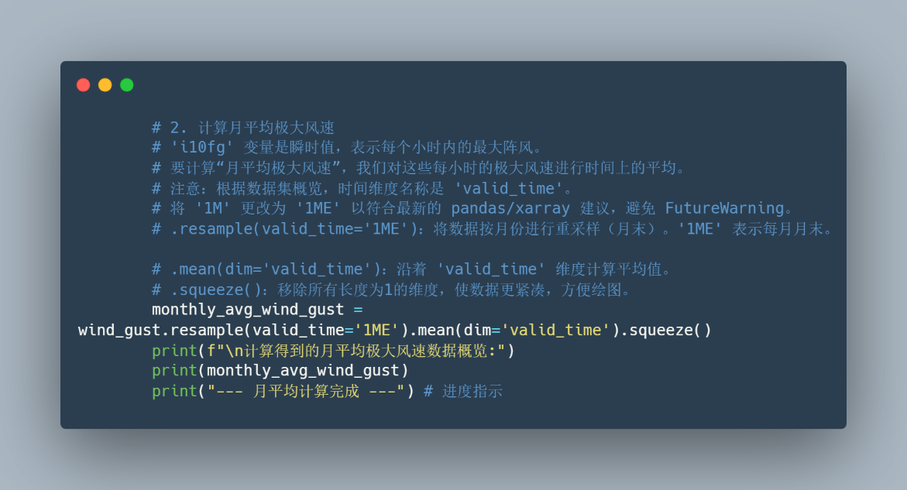

第三步绘制全球分布图。

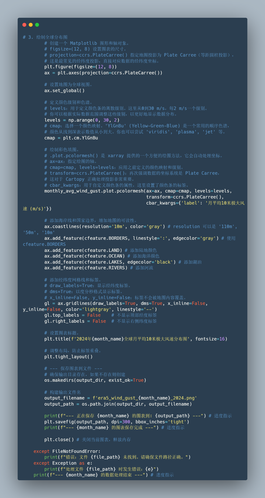

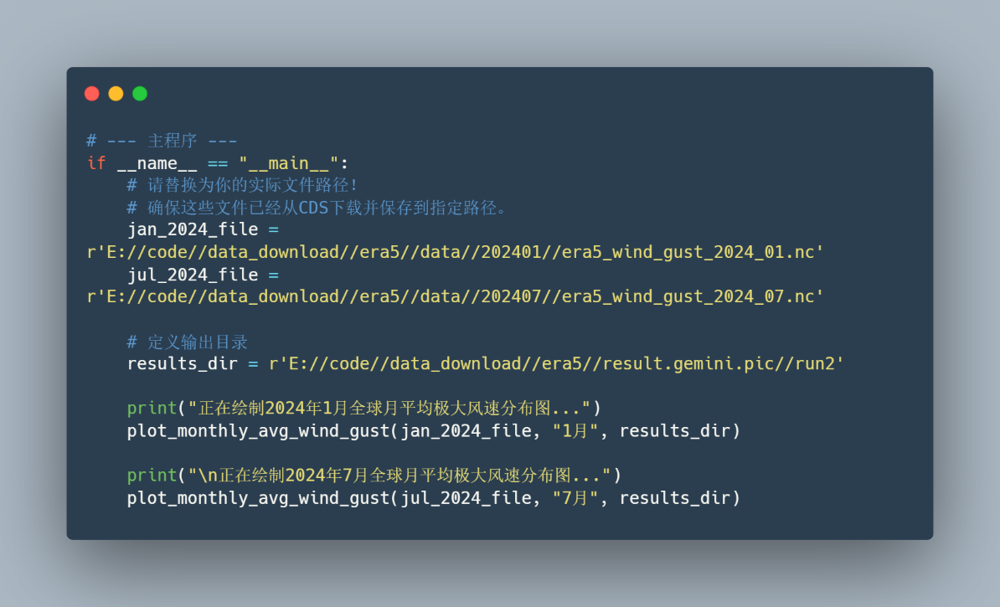

## 4 结果

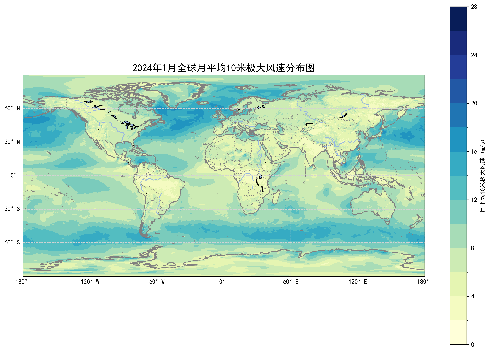

> 图 7 2024 年 1 月全球月平均 10 米极大风速分布图（300dpi）

> 图 8 2024 年 7 月全球月平均 10 米极大风速分布图（300dpi）
